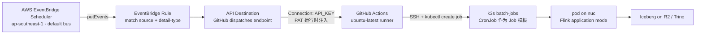

# Scheduled Batch Jobs（个人定时批处理任务总账 + 执行体）

本仓库是**周期性批处理任务的唯一登记处**，同时**承载自研任务的实现代码**（`jobs/`）。

- **登记与说明**：拓扑、任务总账、接线步骤、实战笔记（`docs/`）
- **执行体代码**：每个任务一个目录（`jobs/<name>/`），含程序、Dockerfile 与 README
- **编排**：`Scheduler（AWS）→ GitHub Actions（.github/workflows）→ k8s CronJob 模板（ArgoCD）`

> 第三方/历史业务（如 `sms-flink-etl`）的代码仍留在各自仓库，本仓只登记不复制。

统一架构：

> **AWS EventBridge Scheduler（云端精准时钟）→ GitHub Actions（无状态编排中枢）→ Flink batch / K8s Job（内网弹性执行体）**

---

## 🏛️ 端到端架构拓扑

```text
+---------------------------------------------------------------------------------+
|  [时钟层]  AWS EventBridge Scheduler          region: ap-southeast-1           |
|  - 6 个 Schedule，全部 ENABLED，全部挂在 default bus                            |
|  - 只做一件事：到点往 default event bus 发一条事件（putEvents）                 |
|  - 注意力集中点：这是唯一"谁在什么时候跑什么"的真相来源                          |
+-------------------------------------+-------------------------------------------+
                                      | EventBridge 事件 (source / detail-type)
                                      v
+---------------------------------------------------------------------------------+
|  [路由层]  EventBridge Rule → API Destination → Connection                      |
|  - Rule：按 source + detail-type 匹配，顺带把 inputs 一起塞进 HTTP body         |
|  - API Destination：目标 URL = GitHub workflow_dispatch 端点，限流 1 req/s      |
|  - Connection (API_KEY)：运行时把 PAT 注入 Authorization 头，凭据不落配置       |
+-------------------------------------+-------------------------------------------+
                                      | POST /repos/<owner>/<repo>/actions/workflows/<wf>.yml/dispatches
                                      v
+---------------------------------------------------------------------------------+
|  [编排层]  GitHub Actions (ubuntu-latest, 无状态托管 runner)                    |
|  - 拿到 ref + inputs，跑对应 workflow                                            |
|  - 只负责"把活派给内网"，不承载业务逻辑                                         |
|  - 派活方式：SSH 到 k3s 控制面 → kubectl create job --from=cronjob/<模板>       |
|  - 之后轮询 job 状态、超时判失败、把日志拉进 Step Summary                        |
+-------------------------------------+-------------------------------------------+
                                      | SSH (K3S_HOST / K3S_SSH_USER / K3S_SSH_PRIVATE_KEY)
                                      v
+---------------------------------------------------------------------------------+
|  [执行层]  k3s 集群 (control-plane: 腾讯云 VM-0-2-debian)                       |
|  - namespace batch-jobs 里的 CronJob 是"Job 模板"，SUSPEND=True，自己不触发     |
|  - 真正的 pod 落在 nuc 节点上跑，跑完即销毁                                      |
|  - Flink 以 application mode 自带 mini-cluster（集群内无常驻 Flink 集群）        |
|  - 内网直连：Trino / Iceberg(R2) / AList 等服务都在这张网里，不需要穿透          |
+---------------------------------------------------------------------------------+
```

同一份拓扑的 Mermaid 版本（GitHub 原生渲染）：



---

## 🧩 三层为什么是这三层

| 层 | 选它的唯一理由 | 反过来说，别指望它做这些 |
|---|---|---|
| **AWS Scheduler** | 唯一可靠的时钟。cron 精确、可 `get-schedule` 查、改时间不用碰代码、所有任务在同一张控制台列表里 | 它不能直接调外网 HTTPS，必须经 Rule + API Destination |
| **GitHub Actions** | 无状态、用完即毁、日志与重跑免费、public repo 分钟数无限 | 它**不在你内网**，碰不到 LAN 服务；单 job 上限 6h；`on: schedule` 精度只到 5 分钟且会丢 |
| **Flink batch / K8s Job** | 执行体本来就在内网，能直连 Trino / Iceberg / AList；有状态、有 checkpoint、失败可重跑 | 它不知道自己"该在什么时候跑"，所以时钟必须留在外面 |

一句话：**时钟、编排、执行三件事解耦，各自换掉互不影响**。

---

## 📋 现有任务清单

完整字段（cron、时区、rule、destination、workflow、执行模板）见 [`docs/INVENTORY.md`](docs/INVENTORY.md)。摘要：

| # | Schedule | 频率 | 时区 | 落到哪 |
|---|---|---|---|---|
| 1 | `sms-flink-ingest-10m` | `rate(10 minutes)` | UTC | `sms-flink-etl` → `nuc-batch-runner` |
| 2 | `sms-flink-report-daily` | `50 23 * * ? *` | Asia/Shanghai | `sms-flink-etl` → `nuc-batch-runner`（DAILY） |
| 3 | `sms-flink-report-weekly` | `0 9 ? * MON *` | Asia/Shanghai | `sms-flink-etl` → `nuc-batch-runner`（WEEKLY） |
| 4 | `sms-flink-report-monthly` | `30 9 1 * ? *` | Asia/Shanghai | `sms-flink-etl` → `nuc-batch-runner`（MONTHLY） |
| 5 | `sms-flink-lakehouse-maintain` | `0 4 * * ? *` | Asia/Shanghai | `sms-flink-etl` → `maintain-lakehouse.yml` |
| 6 | `jppwl-tls-cert-renew-weekly` | `0 4 ? * SUN *` | Asia/Shanghai | `my-argocd-manifests` → `renew-jppwl-tls.yml` |
| 7 | `cctv-prune-daily` | `20 4 * * ? *` | Asia/Shanghai | `scheduled-batch-jobs` → `prune-cctv.yml`（真删，保留 14 天） |
| 8 | `demo-email-daily` | `0 9 * * ? *` | Asia/Shanghai | `scheduled-batch-jobs` → `demo-email.yml`（Python 版发信） |
| 9 | `demo-email-java-daily` | `5 9 * * ? *` | Asia/Shanghai | `scheduled-batch-jobs` → `demo-email-java.yml`（Java 版发信） |

> 清单以 AWS 侧实测为准，核对于 2026-11-23。任何新增/下线任务必须同步更新 `docs/INVENTORY.md`。

---

## 📁 目录结构

```
.
├── README.md                      # 本文件：定位 + 拓扑 + 清单摘要
├── docs/
│   ├── ARCHITECTURE.md            # 逐跳细节：真实 ARN、payload、重试/失败语义、备选方案对比
│   ├── INVENTORY.md               # 任务总账：每个 Schedule 的全部字段与排查入口
│   ├── RUNBOOK-add-a-job.md       # 新增一个定时任务的完整接线步骤
│   ├── JOB-cctv-prune.md          # CCTV 保留策略：设计、守卫、节奏、凭据
│   ├── QUARK-API-NOTES.md         # 夸克 API / Cookie 机制的实测笔记
│   ├── CICD-STRATEGY.md           # CI/CD 与 GitOps 部署策略（构建→镜像→回写→同步）
│   └── OPS-NOTES.md               # 运维调优笔记（sysctl 覆盖顺序、swap 语义、内存画像）
├── jobs/                          # 自研任务的实现（程序 + Dockerfile + README）
│   └── cctv-pruner/
│       ├── pruner.py              # 清理逻辑（仅标准库）
│       ├── Dockerfile             # linux/arm64
│       ├── README.md              # 环境变量与本地试跑
│       └── tests/
│           └── test_pruner.py     # 21 个 unittest 用例（无网络）
├── .github/workflows/
│   ├── build-cctv-pruner.yml      # 构建并推送 arm64 镜像
│   └── prune-cctv.yml             # 派发 + 跟单（由 AWS Scheduler 触发）
├── templates/
│   └── workflow-dispatch-consumer.yml   # 消费者 workflow 模板（复制到执行仓库使用）
└── scripts/
    └── register-schedule.sh       # 用 aws cli 注册 Schedule + Rule（幂等、带 dry-run）
```

> k8s 模板（CronJob + ExternalSecret）仍放在 `my-argocd-manifests`，由 ArgoCD 管；本仓只放实现代码与编排。

---

## 🚀 新增一个定时任务

五步，细节见 [`docs/RUNBOOK-add-a-job.md`](docs/RUNBOOK-add-a-job.md)：

1. **执行体**：在执行仓库里把活做成一个 K8s Job 模板（CronJob + `SUSPEND=True`），先能手动跑通
2. **编排**：复制 `templates/workflow-dispatch-consumer.yml`，填 `inputs` 与 job 名
3. **路由**：`aws events create-api-destination` 或复用现有 destination；`aws events put-rule` 建匹配规则
4. **时钟**：`scripts/register-schedule.sh` 注册 Schedule
5. **登记**：更新 `docs/INVENTORY.md`，并在 README 摘要表加一行

---

## ⚖️ 设计约束（新增任务必须满足）

- **幂等**：失败重试会重放。任何"删除 / 写入 / 发送"类动作必须能安全重跑，或自带去重键。
- **先 dry-run**：破坏性任务第一次上线必须只读/dry-run 跑一遍，把计划动作的清单拉出来人工确认。
- **有超时**：workflow `timeout-minutes` + Job `activeDeadlineSeconds` 都必须显式写死，不允许无限等。
- **有并发闸**：workflow 用 `concurrency` 防上一次还没跑完又进来一次（`rate(10 minutes)` 这类高频任务尤其重要）。
- **判失败要严**：不能只看 pod 退出码；日志里出现告警标记也算失败。
- **不做长任务**：单次执行不要接近 6h（GitHub job 硬上限）。真要跑长活，该换成本地 systemd timer。

---

## 🔐 安全边界（本仓库刻意不做的事）

- **不放任何凭据**：Token、私钥、连接串一律在 GitHub Secrets / AWS Secrets Manager 里，仓库里只出现**变量的名字**。
- **只放自研任务的实现，不复制他人代码**：`jobs/` 下的程序在本仓唯一存在；`sms-flink-etl` 等外部业务仍留在各自仓库，本仓只登记，避免"两处真相"。
- **Connection 而不是明文 header**：API Destination 的定义可被 `describe-*` 读出，所以 PAT 只存在于 Secrets Manager，由 Connection 在运行时注入。
- **不用 self-hosted runner 跑 public repo**：public repo + self-hosted runner = 任何人 fork 提 PR 就能在你家机器上执行任意代码。本体系一律用 GitHub 托管 runner。

---

## 🔗 相关仓库与服务

| 对象 | 位置 |
|---|---|
| SMS / Lakehouse 业务流水线 | `nvd11/sms-flink-etl` |
| TLS 证书与 ArgoCD 清单 | `nvd11/my-argocd-manifests` |
| k3s 控制面 | 腾讯云 `VM-0-2-debian`（4 节点：control-plane + free-arm-vm / nuc / radxa-cubie-a7a） |
| 定时任务控制台 | AWS Console → EventBridge → Scheduler（`ap-southeast-1`） |
